<div align="center">




</div>

Thanks for wanting to help! NeuroGrid is a small, **dependency-free educational project**. Please help us keep it that way.

## 📑 Contents

- [Getting set up](#-getting-set-up)
- [Where things live](#-where-things-live)
- [Code conventions](#-code-conventions)
- [Honesty rules](#-honesty-rules)
- [Before you open a PR](#-before-you-open-a-pr)
- [Workflow](#-workflow)
- [Reporting bugs and ideas](#-reporting-bugs-and-ideas)
- [License](#-license)

---

## ⚡ Getting set up

There is **nothing to install**.

```bash
# Serve the project folder
python3 -m http.server 8000      # open http://localhost:8000

# Run the tests (Node 16+)
node tests/dsp.test.js           # also runs tests/v3.test.js
```

> [!TIP]
> Test both ways: over `http://` (Web Worker mode) **and** by opening `index.html` directly via `file://` (main-thread fallback). Both must work.

---

## 🗂️ Where things live

| Folder | Purpose |
|---|---|
| `js/core/` | util, store, loop, progress, csv, db (IndexedDB), sessionstore, datastore |
| `js/dsp/` | FFT, Welch, filters, band power, STFT |
| `js/sim/` | generator, engine, workbench, bci |
| `js/analysis/` | artifacts, topography |
| `js/io/` | CSV import, exporters |
| `js/ml/` | mlp, evalkit, job, worker, runner |
| `js/viz/` | theme, waveform, spectrum, spectrogram, colormaps, fx |
| `js/ui/` | shared controls and charts |
| `js/views/` | one file per section |
| `tests/` | `dsp.test.js`, `v3.test.js` |
| `docs/` | architecture, science, guides |

Read [docs/ARCHITECTURE.md](docs/ARCHITECTURE.md) before making structural changes.

---

## 🧩 Code conventions

**Structure**
- Plain `<script>` tags and the `window.NG` namespace. No modules, no bundler.
- Script order lives in `index.html`. Add new files there, **pure logic before UI**.

**Pure logic must stay pure**
- `dsp`, `stft`, `artifacts`, `topo`, `csvimport`, `evalkit`, `job`, `bci`, `workbench`, `exporters` and `sessionstore` are **UMD**, so they run in the browser, a Worker and Node.
- **No DOM access** in those files.
- **Every one needs tests**, including edge cases.

**Views**
- Expose `render()`, `init(root)`, `show()`, `hide()`.
- Register animation with `NG.loop` **only while visible**.
- Dispose listeners, timers, canvases and workers in `hide` / `dispose`.

**Performance**
- Heavy work (training, long parsing) must be **chunked or in a Worker**, **cancellable**, and **report progress**.

**Styling and state**
- Colours come from `css/tokens.css` / `NG.theme.c`.
- Persist through `NG.store`, `NG.storage` or `NG.db`, **never raw `localStorage`**.

**Accessibility**
- Respect reduced motion.
- Every control needs a label and keyboard access.

**Privacy**
- No runtime dependencies, no network calls, no analytics, no uploads.

---

## 🧭 Honesty rules

NeuroGrid teaches people, so it must never mislead them.

- 🏷️ **Label simulated and imported data** wherever it appears: charts, tables, exports.
- 📏 **Never silently change units or sampling rate.**
- 🚫 **No claims** of thought reading, diagnosis, or real-EEG performance. Don't invent metrics.
- 📉 **Statistically weak analyses** (tiny test sets) must say so.
- 📸 **Screenshots must be real captures.** Don't invent contributors, licences or URLs.

---

## ✅ Before you open a PR

- [ ] `node tests/dsp.test.js` passes, and new logic has tests (including edge cases)
- [ ] The app loads with **no console errors**
- [ ] Checked at **phone, tablet and desktop** widths with **no horizontal scroll**
- [ ] Works with **reduced motion** and with **Workers unavailable** (`file://`)
- [ ] Docs and `CHANGELOG.md` updated
- [ ] You've stated **what you tested and what you did not**

---

## 🔄 Workflow

```text
fork  →  branch  →  change  →  test  →  pull request
```

1. **Fork** the repository and create a branch with a descriptive name (e.g. `fix/csv-time-check` or `feat/new-colormap`).
2. Make **one focused change** per PR.
3. Run the tests and go through the checklist above.
4. Open a pull request describing **what changed, why, and how you tested it**. Screenshots help for UI changes, and they must be real captures.

---

## 🐛 Reporting bugs and ideas

Open an issue and include:

- What you expected vs. what happened
- Steps to reproduce
- Browser, OS and screen size
- Whether you used `http://` or `file://`
- Any console errors

For feature ideas, explain the **learning value**: how does it help someone understand EEG or BCI better?

---

## 📜 License

By contributing, you agree that your contributions are released under the project's license: **[see license](https://github.com/rheillunio2-byte/NeuroGrid?tab=MIT-1-ov-file)**.

<div align="center">

Thank you for helping make NeuroGrid better. 🧠⚡

</div>
