<div align="center">


<a href="https://git.io/typing-svg">
  
</a>

<br/>


[](YOUR_LICENSE_LINK)

**[Quick start](#-quick-start)** · **[Features](#-whats-inside)** · **[Gallery](#-gallery)** · **[Tech stack](#-tech-stack)** · **[Docs](#-documentation)** · **[Contributing](CONTRIBUTING.md)**

</div>

---

<div align="center">
  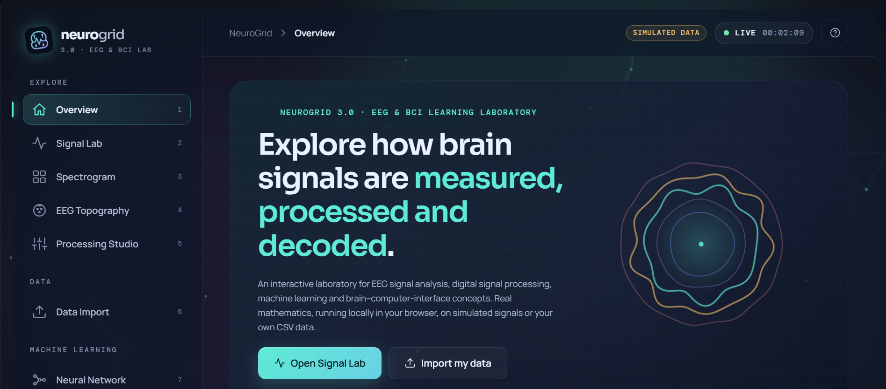
</div>

## 🧠 What is NeuroGrid?

NeuroGrid is a **browser-based laboratory** for learning how EEG signals are generated, inspected, filtered, analysed and used in a brain-computer-interface (BCI) pipeline.

It runs **entirely in your browser**: no server, no upload, no build step, no dependencies. Open it, poke at it, break it, learn from it.

> [!IMPORTANT]
> **Honesty notice.** Built-in signals are **simulated**. A BCI "intent" in the playground is the simulator's own label, not a thought. NeuroGrid is an educational tool: **not a medical device, not for diagnosis**, and its models say nothing about real-EEG performance. Imported CSV data is always labelled **IMPORTED** and stays in your browser.

---

## ✨ What's inside

| | Section | What it does |
|---|---|---|
| 🏠 | **Overview** | Dashboard: stream status, current dataset, recent stored sessions, learning progress, module shortcuts. |
| 📈 | **Signal Lab** | Six simulated channels, seven profiles, live spectrum. Channel comparison, frozen 8 s snapshot with zoom/pan, two-marker measurements (Δt, ΔV), per-channel quality table. |
| 🌈 | **Spectrogram** | Real STFT. Hann / Hamming / Blackman / rectangular windows, size, overlap, frequency range, linear/log axis, Viridis / Inferno / Plasma / Grayscale, dB range, hover readout, playhead. Sources: live stream, simulated recording (128–512 Hz), imported CSV. |
| 🗺️ | **EEG Topography** | Schematic 10–20 map, selectable electrodes, band power, region explanations. Optional interpolated overlay, clearly labelled an **estimate**. |
| 🎛️ | **Processing Studio** | Real Butterworth/biquad filters, filter chain, before/after waveform and PSD. Artifact simulator (blink, EMG, hum, drift, electrode pop, noise) with known ground truth, "Try fix" demos, undo/redo, custom presets. |
| 📥 | **Data Import** | Drag-and-drop CSV, preview, column detection, channel mapping, sampling-rate and unit configuration, validation, time-regularity check, metadata panel. |
| 🤖 | **Neural Network** | Network diagram plus **NN Lab**: configurable MLP, leak-free train/validation/test split, seeds, class balancing, loss/accuracy curves, confusion matrix, precision/recall/F1, Wilson interval, over/underfitting diagnosis, model comparison, JSON config export. |
| 🕹️ | **BCI Playground** | Acquisition → preprocessing → features → classification → output. Four simulated tasks, signal quality that genuinely changes accuracy, four output environments. |
| 🧪 | **Experiments** | Ten modes (Artifact Hunt, Band Identification, Filter Detective, Spectrogram Reading, Model Evaluation, BCI Pipeline and more), three levels, optional timed challenge, review of wrong answers, achievements. |
| 📚 | **Learning Center** | Fifteen topics: spectrograms, scalp maps, artifacts, classifier evaluation, data import and more. |
| 🔬 | **Research Workspace** | Configure → run → review → save → compare → export. Seed, sampling rate, dataset, filter, features, model and split are recorded for reproducibility. CSV, JSON and printable HTML report. |
| 💾 | **Sessions & Export** | Record sessions, store in **IndexedDB**, rename, delete-with-confirmation, compare. Export raw/processed signals, PSD, spectrogram CSV. Records are never silently overwritten. |
| ⚙️ | **Settings** | Theme, accent, motion, mains frequency, full reset (including IndexedDB). |

---

## 🖼️ Gallery

<table>
  <tr>
    <td align="center">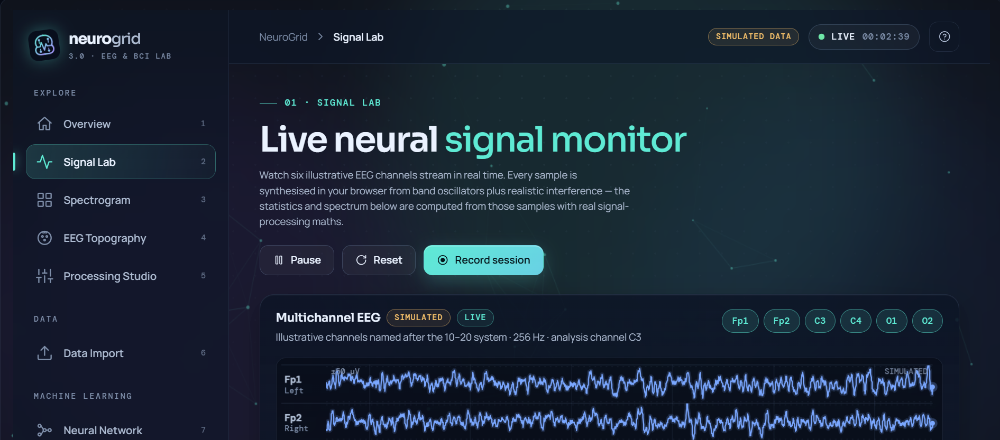<br/><sub><b>Signal Lab</b>: live multichannel EEG</sub></td>
    <td align="center">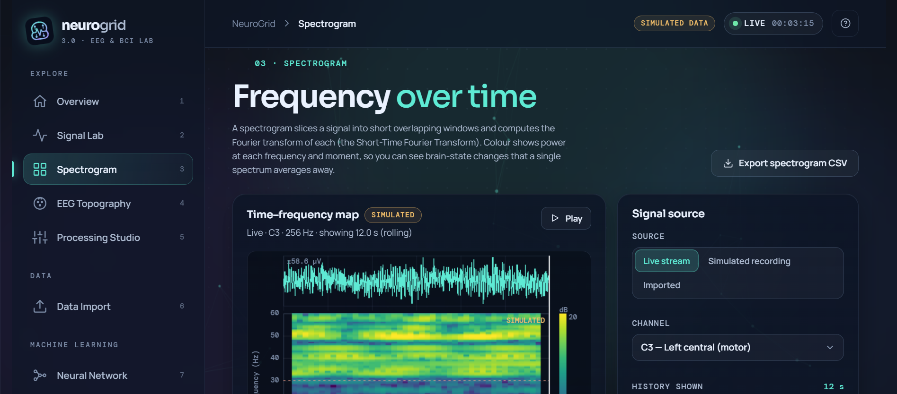<br/><sub><b>Spectrogram</b>: real STFT</sub></td>
  </tr>
  <tr>
    <td align="center">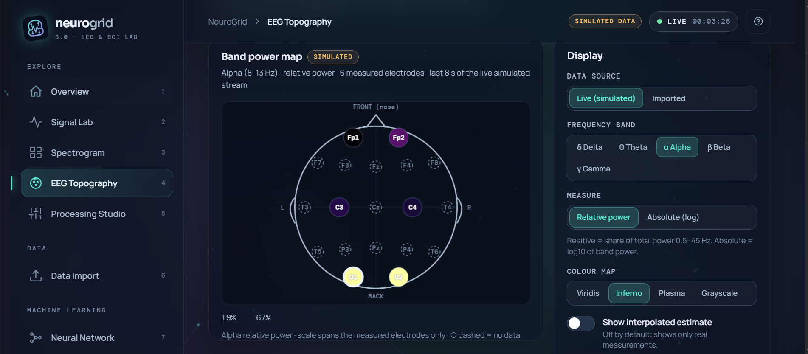<br/><sub><b>EEG Topography</b>: 10–20 band-power map</sub></td>
    <td align="center">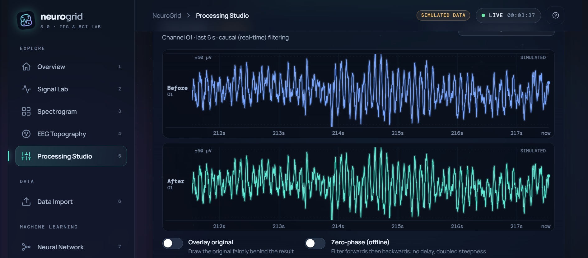<br/><sub><b>Processing Studio</b>: filters and artifacts</sub></td>
  </tr>
  <tr>
    <td align="center">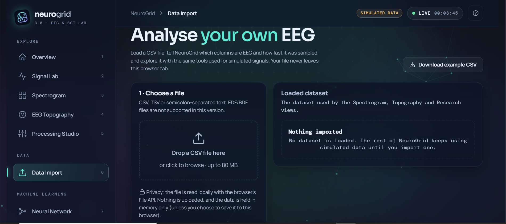<br/><sub><b>Data Import</b>: bring your own CSV</sub></td>
    <td align="center">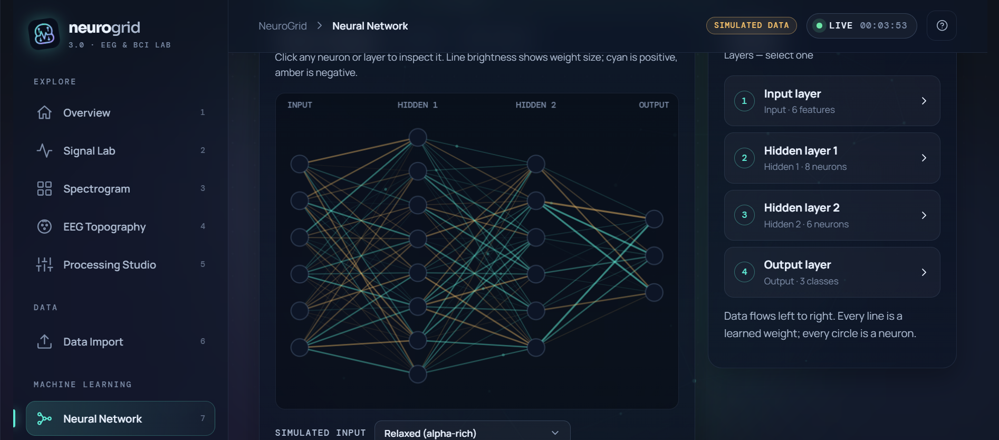<br/><sub><b>Neural Network</b>: NN Lab</sub></td>
  </tr>
</table>

<details>
<summary><b>📸 See more screenshots</b></summary>
<br/>

<table>
  <tr>
    <td align="center">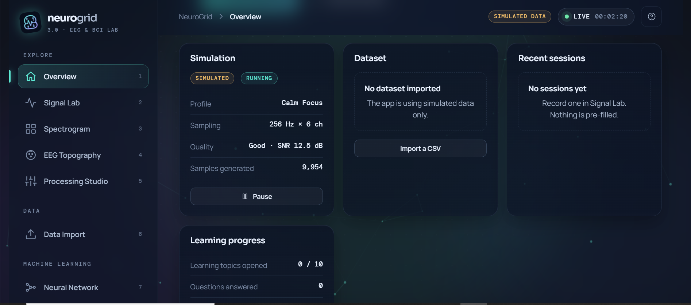</td>
    <td align="center"></td>
  </tr>
  <tr>
    <td align="center">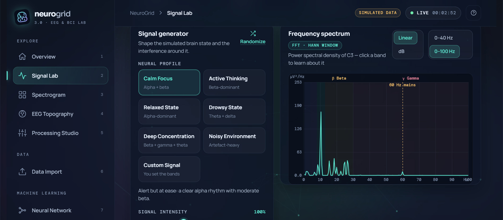</td>
    <td align="center">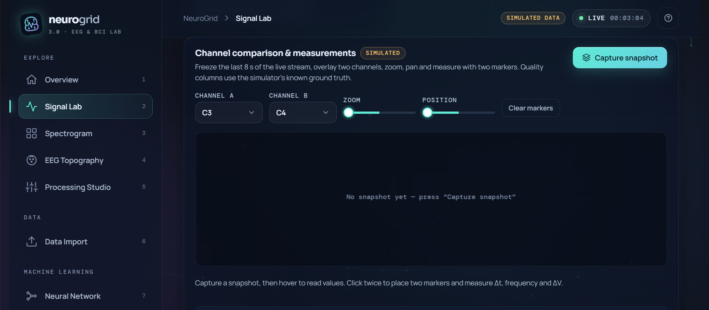</td>
  </tr>
</table>

</details>

---

## 🛠️ Tech stack

<div align="center">


</div>

| Layer | Technology |
|---|---|
| **Language** | Vanilla JavaScript: plain `<script>` tags, no modules, no bundler, everything on `window.NG` |
| **Styling** | CSS custom properties (design tokens), responsive down to 390 px |
| **Rendering** | Canvas 2D, single `requestAnimationFrame` loop |
| **DSP** | Hand-written FFT, Welch PSD, STFT, Butterworth and biquad filters |
| **ML** | Hand-written MLP and evaluation kit, trained in a Web Worker (main-thread fallback) |
| **Storage** | `localStorage` for prefs, **IndexedDB** for sessions and experiments |
| **Testing** | Plain Node scripts (Node 16+), 80 tests |

### 🏗️ Architecture at a glance

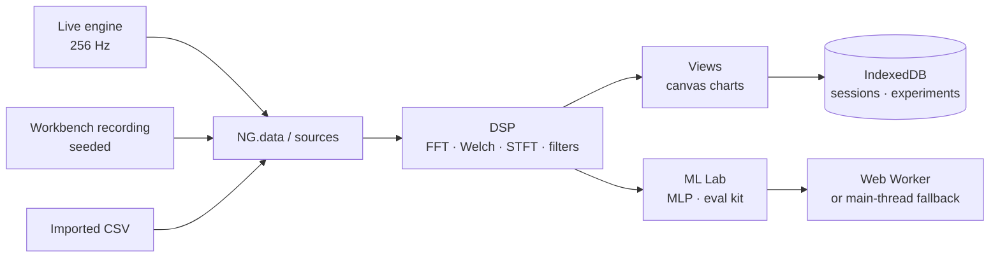

Pure-logic modules (DSP, STFT, artifacts, topography, CSV import, ML) are UMD, so the same code runs in the browser, a Worker and Node.

---

## 🚀 Quick start

```bash
# 1. Serve the folder (any static server works)
python3 -m http.server 8000

# 2. Open it
#    http://localhost:8000

# 3. Run the tests (Node 16+)
node tests/dsp.test.js        # also runs tests/v3.test.js
```

> [!NOTE]
> Opening `index.html` directly (`file://`) works, but browsers block Web Workers there. NN Lab and Research then train in small chunks on the main thread, and the UI tells you which mode is active. Serve over `http://` for worker mode.

**Keyboard shortcuts**

| Key | Action |
|---|---|
| `1`–`9`, `0` | Jump to a section |
| `Space` | Pause / resume the stream |
| `[` | Collapse sidebar |
| `?` | Help |

---

## 📁 Project structure

```text
NeuroGrid/
├── index.html          shell, icon sprite, script order
├── css/                tokens, base, components, layout, views, v3
├── js/
│   ├── core/           util, store, loop, progress, csv, db, sessionstore, datastore
│   ├── dsp/            dsp (FFT, Welch, filters, band power), stft
│   ├── sim/            generator, engine, workbench, bci
│   ├── analysis/       artifacts, topo (10–20 + interpolation)
│   ├── io/             csvimport, exporters
│   ├── ml/             mlp, evalkit, job, worker, runner
│   ├── viz/            theme, waveform, spectrum, spectrogram, colormaps, fx
│   ├── ui/             ui, ctl (controls and charts)
│   └── views/          one file per section
├── tests/              dsp.test.js, v3.test.js
└── docs/               architecture, science, guides
```

---

## 📖 Documentation

| Doc | What's in it |
|---|---|
| [User guide](docs/USER_GUIDE.md) | Walkthrough of every section |
| [Architecture](docs/ARCHITECTURE.md) | Layers, data flow, workers, determinism, storage |
| [Scientific background](docs/SCIENTIFIC_BACKGROUND.md) | The maths, the limits, and what is *not* claimed |
| [Data import](docs/DATA_IMPORT.md) | CSV format, validation, privacy |
| [Research workspace](docs/RESEARCH_WORKSPACE.md) | Reproducible experiments |
| [Testing](docs/TESTING.md) | What was and wasn't tested |
| [Changelog](CHANGELOG.md) | Release history |

---

## ⚠️ Known limitations

We'd rather tell you than have you find out:

- The **live stream is fixed at 256 Hz**. Adjustable rate and duration are in the *Simulated recording* source (Spectrogram, Research).
- **EDF import is not implemented**: CSV only.
- **No PDF export.** The Research report is an HTML file you can print to PDF.
- The Processing Studio **filter chain order is fixed**.
- Topography is a **schematic 2-D layout**; interpolation is an estimate.
- All model results come from simulated data (or your imported labelled windows) and are **not evidence of real-world BCI performance**. Small test sets give wide confidence intervals, and the app says so.
- Browser testing was done in **headless Chromium only** (see [docs/TESTING.md](docs/TESTING.md)).

---

## 🤝 Contributing

Contributions are welcome, as long as NeuroGrid stays small, honest and dependency-free. Please read **[CONTRIBUTING.md](CONTRIBUTING.md)** first.

## 📜 License

Distributed under the license found here: **[LICENSE](https://github.com/rheillunio2-byte/NeuroGrid?tab=MIT-1-ov-file)**.

---

<div align="center">

**Built for learning. Simulated signals, real signal processing.** 🧠⚡


</div>
